# st Design System

You are building UI for **st**. Dark-themed, neutral palette, sans-serif typography (Helvetica Neue), standard density on a 5px grid, expressive motion.

## Visual Reference

**IMPORTANT**: Study ALL screenshots below before writing any UI. Match colors, typography, spacing, layout, and motion exactly as shown.

### Homepage

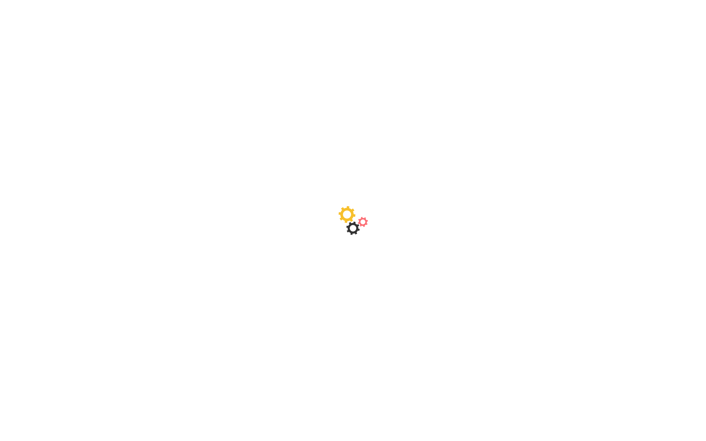

### Scroll Journey (Cinematic Visual States)

> These screenshots capture the website at different scroll depths. The design changes dramatically as you scroll — each frame shows a different cinematic state. Replicate these exact visual transitions.

#### 0% — Hero / Above the fold

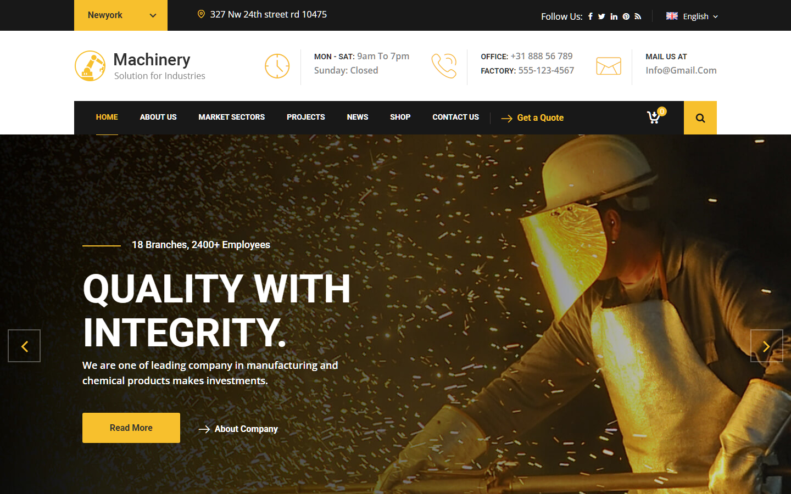

#### 17% — Mid-page at 17% scroll

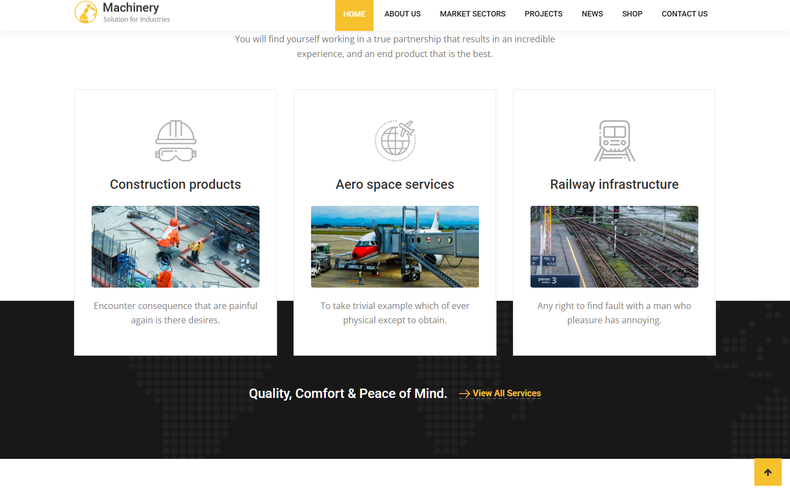

#### 33% — Mid-page at 33% scroll

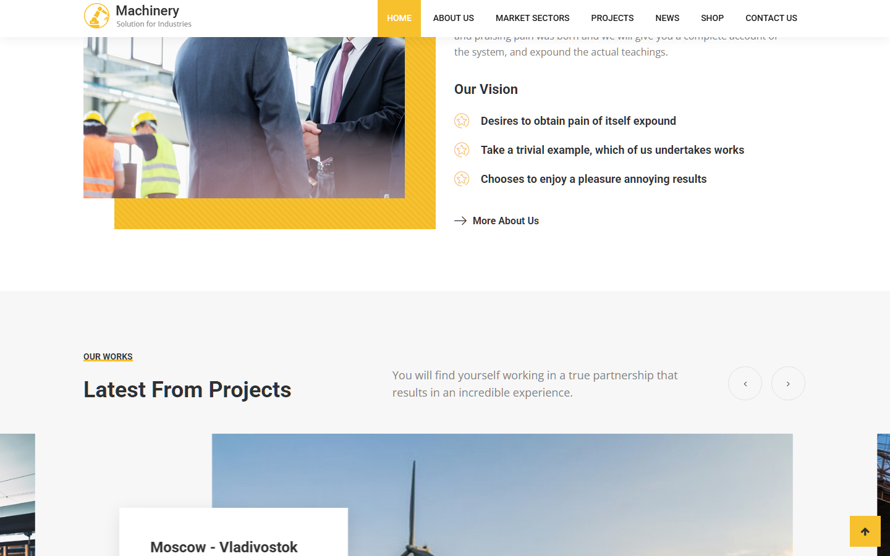

#### 50% — Mid-page at 50% scroll

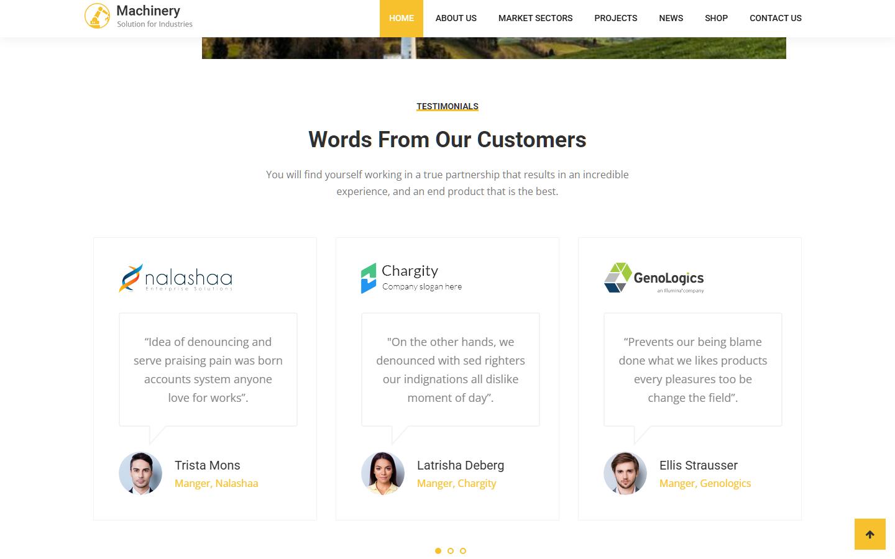

#### 67% — Mid-page at 67% scroll

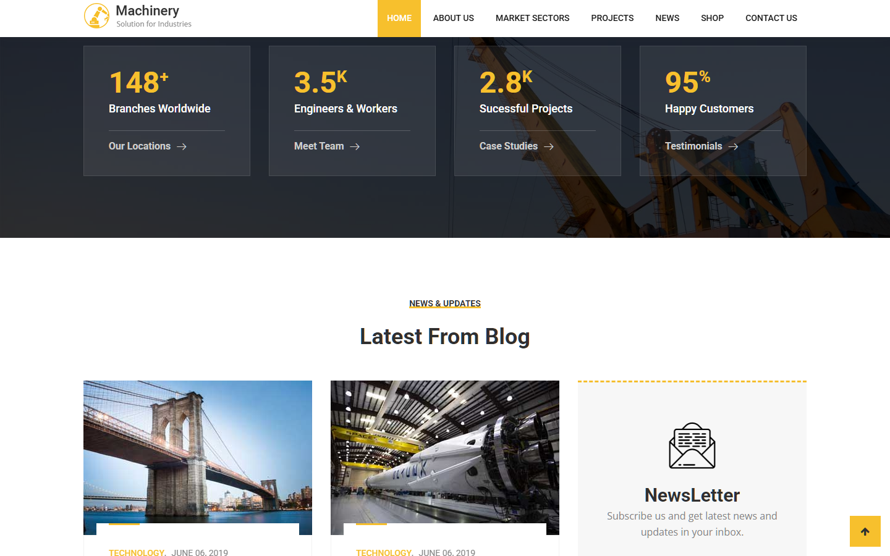

#### 83% — Mid-page at 83% scroll

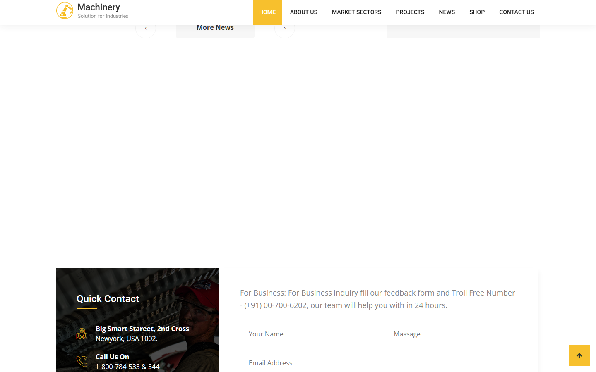

#### 100% — Footer / End of page

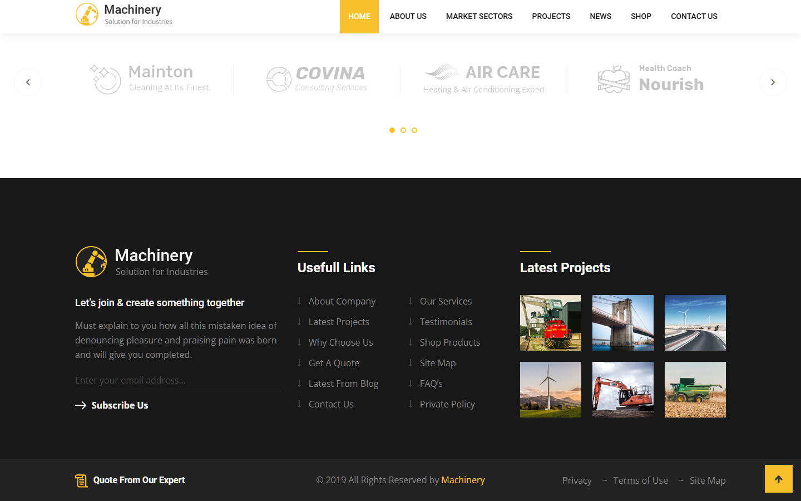

> Read `references/DESIGN.md` for full token details. Read `references/ANIMATIONS.md` for motion specs. Read `references/LAYOUT.md` for layout structure. Read `references/COMPONENTS.md` for component patterns.

## Ultra Reference Files

This package includes extended documentation. **Read these files before implementing:**

| File | Contents |
|------|----------|
| `references/DESIGN.md` | Full design system tokens, colors, typography, spacing |
| `references/VISUAL_GUIDE.md` | **START HERE** — Master visual guide with all screenshots embedded |
| `references/ANIMATIONS.md` | CSS keyframes, scroll triggers, motion library stack, video specs |
| `references/LAYOUT.md` | Flex/grid containers, page structure, spacing relationships |
| `references/COMPONENTS.md` | DOM component patterns, HTML structure, class fingerprints |
| `references/INTERACTIONS.md` | Hover/focus states with before/after style diffs |
| `screens/scroll/` | 7 scroll journey screenshots showing cinematic states |

## Design Philosophy

- **Layered depth** — use shadow tokens to create a sense of physical layering. Each elevation level has a specific shadow.
- **Gradient accents** — gradients are used thoughtfully for emphasis, not decoration.
- **Type pairing** — Helvetica Neue for body/UI text, Arial for headings/display. Never introduce a third typeface.
- **standard density** — 5px base grid. Every dimension is a multiple of 5.
- **neutral palette** — the color temperature runs neutral, matching the sans-serif typography.
- **Expressive motion** — animations are an integral part of the experience. Use spring physics and layout animations.

## Color System

### Core Palette

| Role | Token | Hex | Use |
|------|-------|-----|-----|
| Background | `--background` | `#333333` | Page/app background |
| Surface | `--surface` | `#262626` | Cards, panels, modals |
| Text Primary | `--text-primary` | `#ffffff` | Headings, body text |
| Text Muted | `--text-muted` | `#777777` | Captions, placeholders |
| Border | `--border` | `#444444` | Dividers, card borders |

### Status Colors

| Status | Hex | Use |
|--------|-----|-----|
| Success | `#3c763d` | Confirmations, positive trends |
| Warning | `#f7c02d` | Caution states, pending items |
| Danger | `#a94442` | Errors, destructive actions |

### Extended Palette

- `#888888`
- `#181818` — Deep background layer or shadow color
- `#f3f3f3` — Light surface or highlight color
- `#000000` — Deep background layer or shadow color
- `#2098d1`
- `#e8e8e8` — Light surface or highlight color
- `#cccccc`
- `#337ab7`

## Typography

### Font Stack

- **Helvetica Neue** — Heading 1, Heading 2, Heading 3
- **Arial** — Body, Caption
- **Menlo** — Code

### Font Sources

```css
@font-face {
  font-family: "Open Sans";
  src: url("fonts/OpenSans-Bold.ttf") format("truetype");
  font-weight: 700;
}
@font-face {
  font-family: "Open Sans";
  src: url("fonts/OpenSans-Regular.ttf") format("truetype");
  font-weight: 400;
}
@font-face {
  font-family: "Roboto";
  src: url("fonts/Roboto-Bold.ttf") format("truetype");
  font-weight: 700;
}
@font-face {
  font-family: "Roboto";
  src: url("fonts/Roboto-Regular.ttf") format("truetype");
  font-weight: 400;
}
@font-face {
  font-family: "Flaticon";
  src: url("fonts/Flaticon-Regular.ttf") format("truetype");
  font-weight: 400;
}
@font-face {
  font-family: "machinery-icon";
  src: url("fonts/machinery-icon-Regular.ttf") format("truetype");
  font-weight: 400;
}
```

### Type Scale

| Role | Family | Size | Weight |
|------|--------|------|--------|
| Heading 1 | Helvetica Neue | 130px | 700 |
| Heading 2 | Helvetica Neue | 120px | 700 |
| Heading 3 | Helvetica Neue | 76px | 700 |
| Body | Arial | 16px | 400 |
| Caption | Arial | 14px | 400 |
| Code | Menlo | 14px | 400 |

### Typography Rules

- Body/UI: **Helvetica Neue**, Headings: **Arial** — these are the only display fonts
- Max 3-4 font sizes per screen
- Headings: weight 600-700, body: weight 400
- Use color and opacity for text hierarchy, not additional font sizes
- Line height: 1.5 for body, 1.2 for headings

## Spacing & Layout

### Base Grid: 5px

Every dimension (margin, padding, gap, width, height) must be a multiple of **5px**.

### Spacing Scale

`5, 10, 15, 20, 25, 30, 35, 40, 45, 50, 55, 60` px

### Spacing as Meaning

| Spacing | Use |
|---------|-----|
| 2.5-5px | Tight: related items within a group |
| 10px | Medium: between groups |
| 15-20px | Wide: between sections |
| 30px+ | Vast: major section breaks |

### Border Radius

Scale: `0px 4px 4px 0px, .1em, .12em, .25em, 1px, 1em, 3px, 4px, 5px, 6px, 10px, 15px, 21px, 24px, 100%`
Default: `4px`

### Container

Max-width: `991px`, centered with auto margins.

### Breakpoints

| Name | Value |
|------|-------|
| xs | 320px |
| xs | 375px |
| xs | 479px |
| xs | 480px |
| sm | 550px |
| sm | 599px |
| md | 650px |
| md | 667px |
| md | 767px |
| md | 768px |
| lg | 800px |
| lg | 900px |
| lg | 991px |
| lg | 992px |
| lg | 1023px |
| lg | 1024px |
| xl | 1140px |
| xl | 1199px |
| xl | 1200px |
| 2xl | 1366px |
| 2xl | 1370px |
| 2xl | 1400px |
| 2xl | 1570px |

Mobile-first: design for small screens, layer on responsive overrides.

## Component Patterns

### Card

```css
.card {
  background: #262626;
  border: 1px solid #444444;
  border-radius: 4px;
  padding: 20px;
  box-shadow: 0 0 8px rgba(0,0,0,0.6);
}
```

```html
<div class="card">
  <h3>Card Title</h3>
  <p>Card content goes here.</p>
</div>
```

### Button

```css
/* Primary */
.btn-primary {
  background: #444444;
  color: #ffffff;
  border-radius: 4px;
  padding: 10px 20px;
  font-weight: 500;
  transition: opacity 150ms ease;
}
.btn-primary:hover { opacity: 0.9; }

/* Ghost */
.btn-ghost {
  background: transparent;
  border: 1px solid #444444;
  color: #ffffff;
  border-radius: 4px;
  padding: 10px 20px;
}
```

```html
<button class="btn-primary">Get Started</button>
<button class="btn-ghost">Learn More</button>
```

### Input

```css
.input {
  background: #333333;
  border: 1px solid #444444;
  border-radius: 4px;
  padding: 10px 15px;
  color: #ffffff;
  font-size: 14px;
}
.input:focus { border-color: var(--accent); outline: none; }
```

```html
<input class="input" type="text" placeholder="Search..." />
```

### Badge / Chip

```css
.badge {
  display: inline-flex;
  align-items: center;
  padding: 5px 10px;
  border-radius: 9999px;
  font-size: 12px;
  font-weight: 500;
  background: #262626;
  color: #777777;
}
```

```html
<span class="badge">New</span>
<span class="badge">Beta</span>
```

### Modal / Dialog

```css
.modal-backdrop { background: rgba(0, 0, 0, 0.6); }
.modal {
  background: #262626;
  border: 1px solid #444444;
  border-radius: 100%;
  padding: 30px;
  max-width: 480px;
  width: 90vw;
  box-shadow: 0 6px 12px rgba(0,0,0,.175);
}
```

```html
<div class="modal-backdrop">
  <div class="modal">
    <h2>Dialog Title</h2>
    <p>Dialog content.</p>
    <button class="btn-primary">Confirm</button>
    <button class="btn-ghost">Cancel</button>
  </div>
</div>
```

### Table

```css
.table { width: 100%; border-collapse: collapse; }
.table th {
  text-align: left;
  padding: 10px 15px;
  font-weight: 500;
  font-size: 12px;
  color: #777777;
  text-transform: uppercase;
  letter-spacing: 0.05em;
  border-bottom: 1px solid #444444;
}
.table td {
  padding: 15px;
  border-bottom: 1px solid #444444;
}
```

```html
<table class="table">
  <thead><tr><th>Name</th><th>Status</th><th>Date</th></tr></thead>
  <tbody>
    <tr><td>Item One</td><td>Active</td><td>Jan 1</td></tr>
    <tr><td>Item Two</td><td>Pending</td><td>Jan 2</td></tr>
  </tbody>
</table>
```

### Navigation

```css
.nav {
  display: flex;
  align-items: center;
  gap: 10px;
  padding: 15px 20px;
  border-bottom: 1px solid #444444;
}
.nav-link {
  color: #777777;
  padding: 10px 15px;
  border-radius: 4px;
  transition: color 150ms;
}
.nav-link:hover { color: #ffffff; }
```

```html
<nav class="nav">
  <a href="/" class="nav-link active">Home</a>
  <a href="/about" class="nav-link">About</a>
  <a href="/pricing" class="nav-link">Pricing</a>
  <button class="btn-primary" style="margin-left: auto">Get Started</button>
</nav>
```

### Extracted Components

These components were found in the codebase:

**Button** (`html`)
- Variants: `style-one`, `default`

**List** (`html`)

## Page Structure

The following page sections were detected:

- **Navigation** — Top navigation bar (34 items)
- **Hero** — Hero/banner section with headline and CTAs
- **Faq** — FAQ/accordion section
- **Footer** — Page footer with links and info (24 items)
- **Testimonials** — Testimonials/reviews section
- **Cta** — Call-to-action section

When building pages, follow this section order and structure.

## Animation & Motion

This project uses **expressive motion**. Animations are part of the design language.

### CSS Animations

- `progress-bar-stripes`
- `fa-spin`
- `bounce`
- `flash`
- `pulse`

### Motion Tokens

- **Duration scale:** `0ms`, `0.1s`, `0.15s`, `0.3s`, `.35s`, `0.5s`, `.75s`, `0.75s`, `1s`, `2s`, `100ms`, `150ms`, `200ms`, `250ms`, `300ms`, `400ms`, `500ms`, `600ms`, `1000ms`
- **Easing functions:** `ease-in-out`, `linear`, `ease`, `ease-out`, `cubic-bezier(0.215,0.610,0.355,1.000)`, `cubic-bezier(0.755,0.050,0.855,0.060)`, `ease-in`, `cubic-bezier(0.550,0.055,0.675,0.190)`, `cubic-bezier(0.175,0.885,0.320,1)`, `cubic-bezier(.47,0,.74,.71)`, `cubic-bezier(.22,.61,.36,1)`, `cubic-bezier(0,0,.25,1)`, `cubic-bezier(.19,1,.22,1)`, `cubic-bezier(.25,.46,.45,.94)`, `cubic-bezier(0.47,2.02,0.31,-0.36)`, `cubic-bezier(0.52,1.64,0.37,0.66)`

### Motion Guidelines

- **Duration:** Use values from the duration scale above. Short (0ms) for micro-interactions, long (1000ms) for page transitions
- **Easing:** Use `ease-in-out` as the default easing curve
- **Direction:** Elements enter from bottom/right, exit to top/left
- **Reduced motion:** Always respect `prefers-reduced-motion` — disable animations when set

## Depth & Elevation

### Shadow Tokens

- Subtle: `inset 0-1px 0 rgba(0,0,0,.25)`
- Subtle: `inset 0 1px 1px rgba(0,0,0,.075)`
- Subtle: `inset 0 1px 0 rgba(255,255,255,.1)`
- Subtle: `inset 0 1px 0 rgba(255,255,255,.1),0 1px 0 rgba(255,255,255,.1)`
- Subtle: `inset 0 1px 2px rgba(0,0,0,.1)`
- Subtle: `inset 0-1px 0 rgba(0,0,0,.15)`

### Z-Index Scale

`0, 1, 2, 4, 5, 6, 7, 9, 10, 11, 12, 14, 15, 25, 99, 100, 990, 991, 999, 1000, 1030, 1040, 1042, 1043, 1044, 1045, 1046, 1050, 1060, 1061, 1070, 9999, 99991, 99992, 99994, 99995, 99997, 99999, 999999, 1e+23`

Use these exact values — never invent z-index values.

## Anti-Patterns (Never Do)

- **No blur effects** — no backdrop-blur, no filter: blur()
- **No zebra striping** — tables and lists use borders for separation
- **No invented colors** — every hex value must come from the palette above
- **No arbitrary spacing** — every dimension is a multiple of 5px
- **No extra fonts** — only Helvetica Neue and Arial and Menlo are allowed
- **No arbitrary border-radius** — use the scale: .1em, .12em, .25em, 1px, 1em, 3px, 4px, 5px, 6px, 10px
- **No opacity for disabled states** — use muted colors instead

## Workflow

1. **Read** `references/DESIGN.md` before writing any UI code
2. **Pick colors** from the Color System section — never invent new ones
3. **Set typography** — Helvetica Neue, Arial, Menlo only, using the type scale
4. **Build layout** on the 5px grid — check every margin, padding, gap
5. **Match components** to patterns above before creating new ones
6. **Apply elevation** — use shadow tokens
7. **Validate** — every value traces back to a design token. No magic numbers.

## Brand Spec

- **Favicon:** `images/favicon.png`
- **Site URL:** `https://st.ourhtmldemo.com/new/Machinery/index2.html`
- **Brand typeface:** Helvetica Neue

## Quick Reference

```
Background:     #333333
Surface:        #262626
Text:           #ffffff / #777777
Accent:         (not extracted)
Border:         #444444
Font:           Helvetica Neue
Spacing:        5px grid
Radius:         4px
Components:     9 detected
```

## When to Trigger

Activate this skill when:
- Creating new components, pages, or visual elements for st
- Writing CSS, Tailwind classes, styled-components, or inline styles
- Building page layouts, templates, or responsive designs
- Reviewing UI code for design consistency
- The user mentions "st" design, style, UI, or theme
- Generating mockups, wireframes, or visual prototypes

---

# Full Reference Files

> Every output file is embedded below. Claude has full design system context from /skills alone.

## Design System Tokens (DESIGN.md)

# st DESIGN.md

> Auto-generated design system — reverse-engineered via static analysis by skillui.
> Frameworks: None detected
> Colors: 20 · Fonts: 3 · Components: 9
> Icon library: not detected · State: not detected
> Primary theme: dark · Dark mode toggle: no · Motion: expressive

## Visual Reference

**Match this design exactly** — study colors, fonts, spacing, and component shapes before writing any UI code.


---

## 1. Visual Theme & Atmosphere

This is a **dark-themed** interface with a neutral tone. Depth is expressed through layered shadows and subtle surface color variation. Typography pairs **Arial** for display/headings with **Helvetica Neue** for body text, creating clear visual hierarchy through type contrast. Spacing follows a **5px base grid** (standard density), with scale: 5, 10, 15, 20, 25, 30, 35, 40px. Motion is expressive — spring physics, layout animations, and staggered reveals are part of the visual language.

---

## 2. Color Palette & Roles

| Token | Hex | Role | Use |
|---|---|---|---|
| background | `#333333` | background | Page background, darkest surface |
| surface | `#262626` | surface | Card and panel backgrounds |
| text-primary | `#ffffff` | text-primary | Headings and body text |
| text-muted | `#777777` | text-muted | Captions, placeholders, secondary info |
| border | `#444444` | border | Dividers, card borders, outlines |
| danger | `#a94442` | danger | Error states, destructive actions |
| success | `#3c763d` | success | Success states, positive indicators |
| warning | `#f7c02d` | warning | Warning states, caution indicators |
| info | `#2098d1` | info | Informational highlights |
| unknown | `#888888` | unknown | Palette color |
| unknown | `#181818` | unknown | Palette color |
| unknown | `#f3f3f3` | unknown | Palette color |
| unknown | `#000000` | unknown | Palette color |
| unknown | `#e8e8e8` | unknown | Palette color |
| unknown | `#cccccc` | unknown | Palette color |
| unknown | `#337ab7` | unknown | Palette color |
| unknown | `#dddddd` | unknown | Palette color |
| unknown | `#999999` | unknown | Palette color |
| unknown | `#8a6d3b` | unknown | Palette color |
| unknown | `#555555` | unknown | Palette color |


---

## 3. Typography Rules

**Font Stack:**
- **Helvetica Neue** — Heading 1, Heading 2, Heading 3
- **Arial** — Body, Caption
- **Menlo** — Code

**Font Sources:**

```css
@font-face {
  font-family: "Open Sans";
  src: url("fonts/OpenSans-Bold.ttf") format("truetype");
  font-weight: 700;
}
@font-face {
  font-family: "Open Sans";
  src: url("fonts/OpenSans-Regular.ttf") format("truetype");
  font-weight: 400;
}
@font-face {
  font-family: "Roboto";
  src: url("fonts/Roboto-Bold.ttf") format("truetype");
  font-weight: 700;
}
@font-face {
  font-family: "Roboto";
  src: url("fonts/Roboto-Regular.ttf") format("truetype");
  font-weight: 400;
}
@font-face {
  font-family: "Flaticon";
  src: url("fonts/Flaticon-Regular.ttf") format("truetype");
  font-weight: 400;
}
@font-face {
  font-family: "machinery-icon";
  src: url("fonts/machinery-icon-Regular.ttf") format("truetype");
  font-weight: 400;
}
```

| Role | Font | Size | Weight |
|---|---|---|---|
| Heading 1 | Helvetica Neue | 130px | 700 |
| Heading 2 | Helvetica Neue | 120px | 700 |
| Heading 3 | Helvetica Neue | 76px | 700 |
| Body | Arial | 16px | 400 |
| Caption | Arial | 14px | 400 |
| Code | Menlo | 14px | 400 |

**Typographic Rules:**
- Limit to 3 font families max per screen
- Use **Helvetica Neue** for body/UI text, **Arial** for display/headings
- Maintain consistent hierarchy: no more than 3-4 font sizes per screen
- Headings use bold (600-700), body uses regular (400)
- Line height: 1.5 for body text, 1.2 for headings
- Use color and opacity for secondary hierarchy, not additional font sizes


---

## 4. Component Stylings

### Layout (1)

**Footer** — `html`

### Navigation (1)

**Navigation** — `html`

### Data Display (2)

**Badge** — `html`

**List** — `html`

### Data Input (2)

**Button** — `html`
- Variants: `style-one`, `default`
- Animation: 

**Input** — `html`
- State: :focus, :placeholder

### Overlay (1)

**Modal** — `html`

### Media (2)

**Image** — `html`

**Map/Canvas** — `html`


---

## 5. Layout Principles

- **Base spacing unit:** 5px
- **Spacing scale:** 5, 10, 15, 20, 25, 30, 35, 40, 45, 50, 55, 60
- **Border radius:** 0px 4px 4px 0px, .1em, .12em, .25em, 1px, 1em, 3px, 4px, 5px, 6px, 10px, 15px, 21px, 24px, 100%
- **Max content width:** 991px

**Spacing as Meaning:**
| Spacing | Use |
|---|---|
| 2.5-5px | Tight: related items within a group |
| 10px | Medium: between groups |
| 15-20px | Wide: between sections |
| 30px+ | Vast: major section breaks |


---

## 6. Depth & Elevation

### Flat — subtle depth hints

- `inset 0-1px 0 rgba(0,0,0,.25)`
- `inset 0 1px 1px rgba(0,0,0,.075)`
- `inset 0 1px 0 rgba(255,255,255,.1)`

### Raised — cards, buttons, interactive elements

- `0 0 8px rgba(0,0,0,0.6)`
- `inset 0 1px 1px rgba(0,0,0,.075),0 0 8px rgba(102,175,233,.6)`
- `inset 0 1px 1px rgba(0,0,0,.075),0 0 6px #67b168`

### Floating — dropdowns, popovers, modals

- `0 6px 12px rgba(0,0,0,.175)`
- `0 3px 9px rgba(0,0,0,.5)`
- `0 5px 15px rgba(0,0,0,.5)`

### Overlay — full-screen overlays, top-level dialogs

- `0px 7px 27px 0px rgba(0,0,0,0.11)`
- `0px 7px 25px 0px rgba(0,0,0,0.07)`

### Z-Index Scale

`0, 1, 2, 4, 5, 6, 7, 9, 10, 11, 12, 14, 15, 25, 99, 100, 990, 991, 999, 1000, 1030, 1040, 1042, 1043, 1044, 1045, 1046, 1050, 1060, 1061, 1070, 9999, 99991, 99992, 99994, 99995, 99997, 99999, 999999, 1e+23`


---

## 7. Animation & Motion

This project uses **expressive motion**. Animations are an integral part of the experience.

### CSS Animations

- `@keyframes progress-bar-stripes`
- `@keyframes fa-spin`
- `@keyframes bounce`
- `@keyframes flash`
- `@keyframes pulse`
- `@keyframes rubberBand`
- `@keyframes shake`
- `@keyframes swing`

### Animated Components

- **Button**: 

### Motion Guidelines

- Duration: 150-300ms for micro-interactions, 300-500ms for page transitions
- Easing: `ease-out` for enters, `ease-in` for exits
- Always respect `prefers-reduced-motion`


---

## 8. Do's and Don'ts

### Do's

- Use `#333333` as the primary page background
- Pair **Helvetica Neue** (body) with **Arial** (display) — these are the only allowed fonts
- Follow the **5px** spacing grid for all margins, padding, and gaps
- Use the defined shadow tokens for elevation — see Section 6
- Use border-radius from the scale: 0px 4px 4px 0px, .1em, .12em, .25em, 1px
- Reuse existing components from Section 4 before creating new ones

### Don'ts

- Don't introduce colors outside this palette — extend the design tokens first
- Don't introduce additional font families beyond Helvetica Neue and Arial and Menlo
- Don't use arbitrary spacing values — stick to multiples of 5px
- Don't create custom box-shadow values outside the system tokens
- Don't use arbitrary border-radius values — pick from the defined scale
- Don't duplicate component patterns — check Section 4 first
- Don't use backdrop-blur or blur effects

### Anti-Patterns (detected from codebase)

- No blur or backdrop-blur effects
- No zebra striping on tables/lists


---

## 9. Responsive Behavior

| Name | Value | Source |
|---|---|---|
| xs | 320px | css |
| xs | 375px | css |
| xs | 479px | css |
| xs | 480px | css |
| sm | 550px | css |
| sm | 599px | css |
| md | 650px | css |
| md | 667px | css |
| md | 767px | css |
| md | 768px | css |
| lg | 800px | css |
| lg | 900px | css |
| lg | 991px | css |
| lg | 992px | css |
| lg | 1023px | css |
| lg | 1024px | css |
| xl | 1140px | css |
| xl | 1199px | css |
| xl | 1200px | css |
| 2xl | 1366px | css |
| 2xl | 1370px | css |
| 2xl | 1400px | css |
| 2xl | 1570px | css |

**Approach:** Use `@media (min-width: ...)` queries matching the breakpoints above.


---

## 10. Agent Prompt Guide

Use these as starting points when building new UI:

### Build a Card

```
Background: #262626
Border: 1px solid #444444
Radius: 4px
Padding: 20px
Font: Helvetica Neue
Use shadow tokens from Section 6.
```

### Build a Button

```
Primary: bg var(--accent), text white
Ghost: bg transparent, border #444444
Padding: 10px 20px
Radius: 4px
Hover: opacity 0.9 or lighter shade
Focus: ring with var(--accent)
```

### Build a Page Layout

```
Background: #333333
Max-width: 991px, centered
Grid: 5px base
Responsive: mobile-first, breakpoints from Section 9
```

### Build a Stats Card

```
Surface: #262626
Label: #777777 (muted, 12px, uppercase)
Value: #ffffff (primary, 24-32px, bold)
Status: use success/warning/danger from Section 2
```

### Build a Form

```
Input bg: #333333
Input border: 1px solid #444444
Focus: border-color var(--accent)
Label: #777777 12px
Spacing: 20px between fields
Radius: 4px
```

### General Component

```
1. Read DESIGN.md Sections 2-6 for tokens
2. Colors: only from palette
3. Font: Helvetica Neue, type scale from Section 3
4. Spacing: 5px grid
5. Components: match patterns from Section 4
6. Elevation: shadow tokens
```

## Visual Guide — Screenshots (VISUAL_GUIDE.md)

# st — Visual Guide

> Master visual reference. Study every screenshot carefully before implementing any UI.
> Match colors, layout, typography, spacing, and motion states exactly.

## Scroll Journey

The page has cinematic scroll animations. Each screenshot below shows the exact visual state at that scroll depth.
**Replicate these transitions precisely** — the design changes dramatically as you scroll.

### Hero — Above the fold

*Scroll position: 0px of 7604px total*


### 17% scroll depth

*Scroll position: 1140px of 7604px total*


### 33% scroll depth

*Scroll position: 2212px of 7604px total*


### 50% scroll depth

*Scroll position: 3352px of 7604px total*


### 67% scroll depth

*Scroll position: 4492px of 7604px total*


### 83% scroll depth

*Scroll position: 5564px of 7604px total*


### Footer — End of page

*Scroll position: 6704px of 7604px total*


## Full Page Screenshots

### Machinery - HTML Template | Home

*URL: `https://st.ourhtmldemo.com/new/Machinery/index2.html`*


### Machinery - HTML Template | Home

*URL: `https://st.ourhtmldemo.com/new/Machinery/index.html`*


### Machinery - HTML Template | About Us

*URL: `https://st.ourhtmldemo.com/new/Machinery/about.html`*


### Machinery - HTML Template | Testimonial

*URL: `https://st.ourhtmldemo.com/new/Machinery/testimonial.html`*


### Machinery - HTML Template | FAQ's

*URL: `https://st.ourhtmldemo.com/new/Machinery/faqs.html`*


## Section Screenshots

Clipped sections showing individual components in context.

### Section 1 — `section`

*1440×400px*


### Section 2 — `section`

*1440×633px*


### Section 1 — `section`

*1440×400px*


### Section 2 — `section`

*1440×1200px*


### Section 1 — `section`

*1440×400px*


### Section 2 — `section`

*1440×676px*


## Animations & Motion (ANIMATIONS.md)

# Animation Reference

> Cinematic motion design extracted from live DOM. Follow these specs exactly to recreate the experience.

## Motion Technology Stack

Pure CSS animations — no external animation libraries detected.

## Scroll Journey

The page is **7,604px** tall. Each frame below shows what the user sees at that scroll depth.

> **Use these screenshots to understand WHAT animates, WHEN it animates, and HOW it moves.**

### 0% — Top / Hero
Scroll position: 0px


### 17% — Opening Section
Scroll position: 1,140px


### 33% — First Feature Section
Scroll position: 2,212px


### 50% — Mid-Page
Scroll position: 3,352px


### 67% — Lower Content
Scroll position: 4,492px


### 83% — Near Footer
Scroll position: 5,564px


### 100% — Bottom / Footer
Scroll position: 6,704px


## Scroll Animation Patterns

| Pattern | Library | Element Count | Duration | Delay | Easing |
|---------|---------|---------------|----------|-------|--------|
| scroll-trigger | GSAP | 15 | — | — | — |
| parallax / sticky scroll | CSS | 1 | — | — | — |

### GSAP Implementation

```javascript
// GSAP ScrollTrigger
gsap.registerPlugin(ScrollTrigger);

gsap.from('.element', {
  opacity: 0,
  y: 60,
  duration: 0.8,
  ease: 'power2.out',
  scrollTrigger: {
    trigger: '.element',
    start: 'top 80%',
    end: 'bottom 20%',
  }
});
```

### CSS Implementation

## CSS Keyframes (2 extracted)

### `@keyframes progress-bar-stripes`

Duration: `2s` · Easing: `linear` · Delay: `0s` · Iteration: `infinite` · Fill: `none`

Used by: `.progress-bar.active, .progress.active .progress-bar`

```css
@keyframes progress-bar-stripes {
  0% {
    background-position-x: 40px;
    background-position-y: 0px;
  }
  100% {
    background-position-x: 0px;
    background-position-y: 0px;
  }
}
```

> Background color/gradient shift · Background position (shimmer/scroll)

### `@keyframes progress-bar-stripes`

Duration: `2s` · Easing: `linear` · Delay: `0s` · Iteration: `infinite` · Fill: `none`

Used by: `.progress-bar.active, .progress.active .progress-bar`

```css
@keyframes progress-bar-stripes {
  0% {
    background-position-x: 40px;
    background-position-y: 0px;
  }
  100% {
    background-position-x: 0px;
    background-position-y: 0px;
  }
}
```

> Background color/gradient shift · Background position (shimmer/scroll)

## Global Transition Declarations

These `transition` values were extracted from CSS rules across the site:

```css
transition: 0.2s ease-in-out;
transition: border-color 0.15s ease-in-out, box-shadow 0.15s ease-in-out;
transition: opacity 0.15s linear;
transition: border 0.2s ease-in-out;
transition: width 0.6s;
transition: transform 0.3s ease-out;
transition: left 0.6s ease-in-out;
transition: 0.3s;
transition: 300ms;
transition: 500ms;
transition: 0.4s;
transition: transform 0.4s, -webkit-transform 0.4s;
```

## How to Recreate This Motion Design

### Step 2 — Scroll-Reveal Pattern

Elements that animate into view follow this pattern:

```css
/* Initial hidden state */
.reveal {
  opacity: 0;
  transform: translateY(40px);
  transition: opacity 0.2s cubic-bezier(0.4, 0, 0.2, 1),
              transform 0.2s cubic-bezier(0.4, 0, 0.2, 1);
}
.reveal.visible {
  opacity: 1;
  transform: translateY(0);
}
```

### Step 3 — Key Motion Principles

- **Duration scale:** `0.2s` · `0.15s` — use these values, never invent new durations
- **Always add** `@media (prefers-reduced-motion: reduce) { * { animation-duration: 0.01ms !important; transition-duration: 0.01ms !important; } }`

### Step 4 — Scroll Journey Reference

Match what happens at each scroll position:

- **0%** (`0px`) → `screens/scroll/scroll-000.png`
- **17%** (`1140px`) → `screens/scroll/scroll-017.png`
- **33%** (`2212px`) → `screens/scroll/scroll-033.png`
- **50%** (`3352px`) → `screens/scroll/scroll-050.png`
- **67%** (`4492px`) → `screens/scroll/scroll-067.png`
- **83%** (`5564px`) → `screens/scroll/scroll-083.png`
- **100%** (`6704px`) → `screens/scroll/scroll-100.png`

## Layout & Grid (LAYOUT.md)

# Layout Reference

> Auto-extracted from live DOM. Use this to understand how the site is structured spatially.

## Spacing System

**Base grid:** 5px

**Scale:** `5, 10, 15, 20, 25, 30, 35, 40, 45, 50, 55, 60, 65, 70, 75` px

| Spacing | Semantic Use |
|---------|-------------|
| 5px | Tight — within a component |
| 10px | Medium — between sibling items |
| 20px | Wide — between sections |
| 40px | Vast — major section breaks |

## Structural Containers

### `<header>` (`header.main-header.style-three`)

```
display:          block
children:         4
```

### `<footer>` (`footer.main-footer.padding-top`)

```
display:          block
children:         2
```

### `<section>` (`section.services-style-one`)

```
display:          block
padding:          100px 0px 0px
children:         1
```

### `<section>` (`section.more-service-link-box.text-center`)

```
display:          block
padding:          150px 0px 100px
children:         1
```

### `<section>` (`section.about-style-one`)

```
display:          block
padding:          100px 0px
children:         1
```

### `<section>` (`section.project-style-two`)

```
display:          block
padding:          100px 0px 0px
children:         2
```

### `<section>` (`section.testimonial-section-home-two`)

```
display:          block
padding:          0px 0px 120px
children:         1
```

### `<section>` (`section.fun-fact-style-one`)

```
display:          block
padding:          99.75px 0px
children:         1
```

### `<section>` (`section.blog-style-two`)

```
display:          block
padding:          100px 0px
children:         1
```

### `<section>` (`section.contact-map-section`)

```
display:          block
children:         1
```

### `<section>` (`section.contact-section.request-qoute-content-block`)

```
display:          block
children:         1
```

### `<section>` (`section.client-carousel-wrapper-two`)

```
display:          block
padding:          100px 0px 150px
children:         1
```

## Layout Rules

- **Container max-width:** `1200px` — always center with `margin: auto`
- Every spacing value must be a multiple of **5px**
- Never use arbitrary margin/padding values outside the spacing scale

## Component Patterns (COMPONENTS.md)

# Component Reference

> Repeated DOM patterns detected by structural analysis. Each component appeared 3+ times.

## Detected Components

| Component | Category | Instances | Key Classes |
|-----------|----------|-----------|-------------|
| **Item** | card | 34× | `.item` |
| **Cloned** | card | 30× | `.cloned`, `.owl-item` |
| **Dropdown** | list-item | 10× | `.dropdown` |
| **Auto Container** | unknown | 6× | `.auto-container` |
| **Auto Container** | unknown | 5× | `.auto-container` |
| **More Btn** | button | 5× | `.more-btn` |
| **Row** | unknown | 4× | `.row` |
| **Owl Stage Outer** | badge | 4× | `.owl-stage-outer` |
| **Owl Stage** | badge | 4× | `.owl-stage` |
| **Info Box** | unknown | 3× | `.info-box`, `.upper-column` |
| **Icon Box** | unknown | 3× | `.icon-box` |
| **Text** | unknown | 3× | `.text` |
| **Col Md 4** | unknown | 3× | `.col-md-4`, `.col-sm-6`, `.col-xs-12` |
| **Single Service Style One** | unknown | 3× | `.single-service-style-one`, `.text-center` |
| **Icon Box** | unknown | 3× | `.icon-box` |
| **Hover Icon** | unknown | 3× | `.hover-icon` |
| **Normal Icon** | unknown | 3× | `.normal-icon` |
| **Image Box** | unknown | 3× | `.image-box` |
| **Box** | unknown | 3× | `.box` |
| **More Link** | unknown | 3× | `.more-link` |

## Cards

### Item

**Instances found:** 34

**CSS classes:** `.item`

**HTML structure:**

```html
<div class="item"> <div class="single-project-box-two"> <div class="image-box clearfix">  </div><!-- /.image-box --> <div class="content-box"> <h3>Moscow - Vladivostok</h3> <span>Railway Infrastucture</span> <p>How all this mistakens denouncings pleas…</p> <a href="#" class="more"><i class="machinery-icon-next"></i> Read More</a> </div><!-- /.content-box --> </div><!-- /.single-project-box-two --> </div>
```

**Base styles (from design tokens):**

```css
.item {
  background: #262626;
  border: 1px solid #444444;
  border-radius: 4px;
  padding: 10px;
}```

### Cloned

**Instances found:** 30

**CSS classes:** `.cloned` `.owl-item`

**HTML structure:**

```html
<div class="owl-item cloned" style="width: 1090px;"><div class="item"> <div class="single-project-box-two"> <div class="image-box clearfix">  </div><!-- /.image-box --> <div class="content-box"> <h3>Moscow - Vladivostok</h3> <span>Railway Infrastucture</span> <p>How all this mistakens denouncings pleas…</p> <a href="#" class="more"><i class="machinery-icon-next"></i> Read More</a> </div><!-- /.content-box --> </div><!-- /.single-project-box-two --> </div></div>
```

**Base styles (from design tokens):**

```css
.cloned {
  background: #262626;
  border: 1px solid #444444;
  border-radius: 4px;
  padding: 10px;
}```

## List Items

### Dropdown

**Instances found:** 10

**CSS classes:** `.dropdown`

**HTML structure:**

```html
<li class="dropdown"><a href="#">About Us</a> <ul> <li><a href="about.html">About Company</a></li> <li><a href="testimonial.html">Testimonials</a></li> <li><a href="faqs.html">FAQ’s</a></li> <li><a href="pricing.html">Pricing Table</a></li> </ul> <div class="dropdown-btn"><span class="fa fa-angle-down"></span></div></li>
```

**Base styles (from design tokens):**

```css
.dropdown {
  padding: 5px 0;
  border-bottom: 1px solid #444444;
}```

## Buttons

### More Btn

**Instances found:** 5

**CSS classes:** `.more-btn`

**HTML structure:**

```html
<a href="#" class="more-btn"><i class="machinery-icon-next"></i>More About Us</a>
```

**Base styles (from design tokens):**

```css
.more-btn {
  color: #ffffff;
  border-radius: 4px;
  padding: 5px 10px;
  cursor: pointer;
}```

## Badges & Chips

### Owl Stage Outer

**Instances found:** 4

**CSS classes:** `.owl-stage-outer`

**HTML structure:**

```html
<div class="owl-stage-outer"><div class="owl-stage" style="transition: all; width: 7980px; padding-left: 175px; padding-right: 175px; transform: translate3d(-2180px, 0px, 0px);"><div class="owl-item cloned" style="width: 1090px;"><div class="item"> <div class="single-project-box-two"> <div class="image-box clearfix">  </div><!-- /.image-box --> <div class="content-box"> <h3>Moscow - Vladivostok</h3> <span>Railway Infrastucture</span> <p>How all this mistakens denouncings pleas…</p> <a href="#" class="more"><i class="machinery-icon-
```

**Base styles (from design tokens):**

```css
.owl-stage-outer {
  background: #262626;
  border: 1px solid #444444;
  border-radius: 4px;
  padding: 3px 5px;
  font-size: 12px;
}```

### Owl Stage

**Instances found:** 4

**CSS classes:** `.owl-stage`

**HTML structure:**

```html
<div class="owl-stage" style="transition: all; width: 7980px; padding-left: 175px; padding-right: 175px; transform: translate3d(-2180px, 0px, 0px);"><div class="owl-item cloned" style="width: 1090px;"><div class="item"> <div class="single-project-box-two"> <div class="image-box clearfix">  </div><!-- /.image-box --> <div class="content-box"> <h3>Moscow - Vladivostok</h3> <span>Railway Infrastucture</span> <p>How all this mistakens denouncings pleas…</p> <a href="#" class="more"><i class="machinery-icon-next"></i> Read More</a> </di
```

**Base styles (from design tokens):**

```css
.owl-stage {
  background: #262626;
  border: 1px solid #444444;
  border-radius: 4px;
  padding: 3px 5px;
  font-size: 12px;
}```

## Other Components

### Auto Container

**Instances found:** 6

**CSS classes:** `.auto-container`

**HTML structure:**

```html
<div class="auto-container"> <div class="clearfix"> <div class="pull-left logo-outer"> <div class="logo"><a href="index.html"></a></div> </div> <div class="pull-right upper-right clearfix"> <!--Info Box--> <div class="upper-column info-box"> <div class="icon-box"><span class="machinery-icon-clock"></span></div> <ul> <li><strong>Mon - Sat:</strong> 9am to 7pm</li> </ul> </div> <!--Info Box--> <!--Info Box--> </div> </div> </div>
```

**Base styles (from design tokens):**

```css
.auto-container {
  background: #262626;
  padding: 5px;
}```

### Auto Container

**Instances found:** 5

**CSS classes:** `.auto-container`

**HTML structure:**

```html
<div class="auto-container"> <div class="sec-title text-center"> <h4>Our Services</h4> <h2>Our Market Sectors</h2> <div class="text">You will find yourself working in a true partnership that results in an incredible <br> experience, and an end product that is the best.</div><!-- /.text --> </div><!-- /.sec-title --> <div class="row"> <div class="col-md-4 col-sm-6 col-xs-12"> <div class="single-service-style-one text-center"> <div class="icon-box">   <div class="col-md-6"> <div class="image-box">  </div><!-- /.image-box --> </div><!-- /.col-md-6 --> <div class="col-md-6"> <div class="sec-title"> <h4>Company</h4> <h2>About Our Company</h2> </div><!-- /.sec-title --> <div class="content-box"> <h3>Our Mission</h3> <p>Must explain to you how all this mistake…</p> <h3>Our Vision</h3> <ul class="list-items"> …</ul> </div><!-- /.content-box --> </div><!-- /.col-md-6 --> </div>
```

**Base styles (from design tokens):**

```css
.row {
  background: #262626;
  padding: 5px;
}```

### Info Box

**Instances found:** 3

**CSS classes:** `.info-box` `.upper-column`

**HTML structure:**

```html
<div class="upper-column info-box"> <div class="icon-box"><span class="machinery-icon-clock"></span></div> <ul> <li><strong>Mon - Sat:</strong> 9am to 7pm</li> <li>Sunday: Closed</li> </ul> </div>
```

**Base styles (from design tokens):**

```css
.info-box {
  background: #262626;
  padding: 5px;
}```

### Icon Box

**Instances found:** 3

**CSS classes:** `.icon-box`

**HTML structure:**

```html
<div class="icon-box"><span class="machinery-icon-clock"></span></div>
```

**Base styles (from design tokens):**

```css
.icon-box {
  background: #262626;
  padding: 5px;
}```

### Text

**Instances found:** 3

**CSS classes:** `.text`

**HTML structure:**

```html
<div class="text">You will find yourself working in a true partnership that results in an incredible <br> experience, and an end product that is the best.</div>
```

**Base styles (from design tokens):**

```css
.text {
  background: #262626;
  padding: 5px;
}```

### Col Md 4

**Instances found:** 3

**CSS classes:** `.col-md-4` `.col-sm-6` `.col-xs-12`

**HTML structure:**

```html
<div class="col-md-4 col-sm-6 col-xs-12"> <div class="single-service-style-one text-center"> <div class="icon-box">   </div><!-- /.icon-box --> <h3><a href="#">Construction products</a></h3> <div class="image-box">  <div class="box"> <a href="#" class="more-link"><i class="machinery-icon-next"></i>Read More</a> </div><!-- /.box --> </div><!-- /.image-bo
```

**Base styles (from design tokens):**

```css
.col-md-4 {
  background: #262626;
  padding: 5px;
}```

### Single Service Style One

**Instances found:** 3

**CSS classes:** `.single-service-style-one` `.text-center`

**HTML structure:**

```html
<div class="single-service-style-one text-center"> <div class="icon-box">   </div><!-- /.icon-box --> <h3><a href="#">Construction products</a></h3> <div class="image-box">  <div class="box"> <a href="#" class="more-link"><i class="machinery-icon-next"></i>Read More</a> </div><!-- /.box --> </div><!-- /.image-box --> <p>Encounter consequence that are pa
```

**Base styles (from design tokens):**

```css
.single-service-style-one {
  background: #262626;
  padding: 5px;
}```

### Icon Box

**Instances found:** 3

**CSS classes:** `.icon-box`

**HTML structure:**

```html
<div class="icon-box">   </div>
```

**Base styles (from design tokens):**

```css
.icon-box {
  background: #262626;
  padding: 5px;
}```

### Hover Icon

**Instances found:** 3

**CSS classes:** `.hover-icon`

**HTML structure:**

```html

```

**Base styles (from design tokens):**

```css
.hover-icon {
  background: #262626;
  padding: 5px;
}```

### Normal Icon

**Instances found:** 3

**CSS classes:** `.normal-icon`

**HTML structure:**

```html

```

**Base styles (from design tokens):**

```css
.normal-icon {
  background: #262626;
  padding: 5px;
}```

### Image Box

**Instances found:** 3

**CSS classes:** `.image-box`

**HTML structure:**

```html
<div class="image-box">  <div class="box"> <a href="#" class="more-link"><i class="machinery-icon-next"></i>Read More</a> </div><!-- /.box --> </div>
```

**Base styles (from design tokens):**

```css
.image-box {
  background: #262626;
  padding: 5px;
}```

### Box

**Instances found:** 3

**CSS classes:** `.box`

**HTML structure:**

```html
<div class="box"> <a href="#" class="more-link"><i class="machinery-icon-next"></i>Read More</a> </div>
```

**Base styles (from design tokens):**

```css
.box {
  background: #262626;
  padding: 5px;
}```

### More Link

**Instances found:** 3

**CSS classes:** `.more-link`

**HTML structure:**

```html
<a href="#" class="more-link"><i class="machinery-icon-next"></i>Read More</a>
```

**Base styles (from design tokens):**

```css
.more-link {
  background: #262626;
  padding: 5px;
}```

## Component Rules

- Match class names exactly from the patterns above
- Each component instance must be visually identical to others of its type
- Do not add extra wrappers or change the DOM structure
- Use `#444444` for all dividers within components

## Interactions & States (INTERACTIONS.md)

# Interaction Reference

> Micro-interactions extracted from live DOM. Recreate these exactly for authentic feel.

## Coverage

| Component Type | Count | States Captured |
|----------------|-------|----------------|
| Button | 3 | default, hover, focus |
| Role Button | 2 | default, hover, focus |
| Link | 3 | default, hover, focus |
| Input | 3 | default, hover, focus |

## Transition System

These transition declarations were extracted from interactive elements:

```css
transition: all;
transition: 0.3s;
transition: 0.5s;
```

Apply these to all interactive elements. Never invent new durations or easings.

## Button Interactions

### Button 1 — `Newyork`

**States:**

- Default: `../screens/states/button-1-default.png`
- Hover: `../screens/states/button-1-hover.png`
- Focus: `../screens/states/button-1-focus.png`

**Transition:** `all`

_No visible style changes detected for this element._

### Button 2 — `Subscribe Us`

**States:**

- Default: `../screens/states/button-2-default.png`
- Hover: `../screens/states/button-2-hover.png`
- Focus: `../screens/states/button-2-focus.png`

**On hover:**

```css
/* background-color: rgb(247, 192, 45) → */ background-color: rgb(48, 48, 48);
/* color: rgb(48, 48, 48) → */ color: rgb(247, 192, 45);
/* border-color: rgb(48, 48, 48) → */ border-color: rgb(247, 192, 45);
/* outline: rgb(48, 48, 48) none 3px → */ outline: rgb(247, 192, 45) none 3px;
/* outline-color: rgb(48, 48, 48) → */ outline-color: rgb(247, 192, 45);
```

**Transition:** `0.3s`

### Button 3 — `Submit Now`

**States:**

- Default: `../screens/states/button-3-default.png`
- Hover: `../screens/states/button-3-hover.png`
- Focus: `../screens/states/button-3-focus.png`

**On hover:**

```css
/* background-color: rgb(247, 247, 247) → */ background-color: rgb(48, 48, 48);
/* color: rgb(48, 48, 48) → */ color: rgb(247, 192, 45);
/* border-color: rgb(48, 48, 48) → */ border-color: rgb(247, 192, 45);
/* outline: rgb(48, 48, 48) none 3px → */ outline: rgb(247, 192, 45) none 3px;
/* outline-color: rgb(48, 48, 48) → */ outline-color: rgb(247, 192, 45);
```

**Transition:** `0.3s`

## Role Button Interactions

### Role Button 1 — `Previous`

**States:**

- Default: `../screens/states/role-button-1-default.png`
- Hover: `../screens/states/role-button-1-hover.png`
- Focus: `../screens/states/role-button-1-focus.png`

**On hover:**

```css
/* background-color: rgba(0, 0, 0, 0) → */ background-color: rgba(247, 192, 45, 0.906);
/* color: rgb(247, 192, 45) → */ color: rgb(254, 249, 235);
/* border-color: rgba(255, 255, 255, 0.3) → */ border-color: rgba(247, 194, 51, 0.933);
/* outline: rgb(247, 192, 45) none 3px → */ outline: rgb(254, 249, 235) none 1px;
/* outline-color: rgb(247, 192, 45) → */ outline-color: rgb(254, 249, 235);
```

**On focus:**

```css
/* outline: rgb(247, 192, 45) none 3px → */ outline: rgb(247, 192, 45) none 1px;
```

**Transition:** `0.5s`

### Role Button 2 — `Next`

**States:**

- Default: `../screens/states/role-button-2-default.png`
- Hover: `../screens/states/role-button-2-hover.png`
- Focus: `../screens/states/role-button-2-focus.png`

**On hover:**

```css
/* background-color: rgba(0, 0, 0, 0) → */ background-color: rgba(247, 192, 45, 0.906);
/* color: rgb(247, 192, 45) → */ color: rgb(254, 249, 235);
/* border-color: rgba(255, 255, 255, 0.3) → */ border-color: rgba(247, 194, 51, 0.933);
/* outline: rgb(247, 192, 45) none 3px → */ outline: rgb(254, 249, 235) none 1px;
/* outline-color: rgb(247, 192, 45) → */ outline-color: rgb(254, 249, 235);
```

**On focus:**

```css
/* outline: rgb(247, 192, 45) none 3px → */ outline: rgb(247, 192, 45) none 1px;
```

**Transition:** `0.5s`

## Link Interactions

### Link 1 — `a`

**States:**

- Default: `../screens/states/link-1-default.png`
- Hover: `../screens/states/link-1-hover.png`
- Focus: `../screens/states/link-1-focus.png`

**On hover:**

```css
/* color: rgb(247, 192, 45) → */ color: rgb(35, 82, 124);
/* border-color: rgb(247, 192, 45) → */ border-color: rgb(35, 82, 124);
/* outline: rgb(247, 192, 45) none 3px → */ outline: rgb(35, 82, 124) none 3px;
/* outline-color: rgb(247, 192, 45) → */ outline-color: rgb(35, 82, 124);
```

**On focus:**

```css
/* color: rgb(247, 192, 45) → */ color: rgb(35, 82, 124);
/* border-color: rgb(247, 192, 45) → */ border-color: rgb(35, 82, 124);
/* outline: rgb(247, 192, 45) none 3px → */ outline: rgb(35, 82, 124) none 3px;
/* outline-color: rgb(247, 192, 45) → */ outline-color: rgb(35, 82, 124);
```

**Transition:** `all`

### Link 2 — `0`

**States:**

- Default: `../screens/states/link-2-default.png`
- Hover: `../screens/states/link-2-hover.png`
- Focus: `../screens/states/link-2-focus.png`

**On hover:**

```css
/* color: rgb(247, 192, 45) → */ color: rgb(35, 82, 124);
/* border-color: rgb(247, 192, 45) → */ border-color: rgb(35, 82, 124);
/* outline: rgb(247, 192, 45) none 3px → */ outline: rgb(35, 82, 124) none 3px;
/* outline-color: rgb(247, 192, 45) → */ outline-color: rgb(35, 82, 124);
```

**On focus:**

```css
/* color: rgb(247, 192, 45) → */ color: rgb(35, 82, 124);
/* border-color: rgb(247, 192, 45) → */ border-color: rgb(35, 82, 124);
/* outline: rgb(247, 192, 45) none 3px → */ outline: rgb(35, 82, 124) none 3px;
/* outline-color: rgb(247, 192, 45) → */ outline-color: rgb(35, 82, 124);
```

**Transition:** `all`

### Link 3 — `a`

**States:**

- Default: `../screens/states/link-3-default.png`
- Hover: `../screens/states/link-3-hover.png`
- Focus: `../screens/states/link-3-focus.png`

**Transition:** `all`

_No visible style changes detected for this element._

## Input Interactions

### Input 1 — `Name`

**States:**

- Default: `../screens/states/input-1-default.png`
- Hover: `../screens/states/input-1-hover.png`
- Focus: `../screens/states/input-1-focus.png`

**Transition:** `all`

_No visible style changes detected for this element._

### Input 2 — `Email Address`

**States:**

- Default: `../screens/states/input-2-default.png`
- Hover: `../screens/states/input-2-hover.png`
- Focus: `../screens/states/input-2-focus.png`

**Transition:** `all`

_No visible style changes detected for this element._

### Input 3 — `Your Name`

**States:**

- Default: `../screens/states/input-3-default.png`
- Hover: `../screens/states/input-3-hover.png`
- Focus: `../screens/states/input-3-focus.png`

**On focus:**

```css
/* border-color: rgb(239, 239, 239) → */ border-color: rgb(247, 192, 45);
```

**Transition:** `0.3s`

## Interaction Rules

- Hover effects include **color transitions** — use the extracted values, not approximations
- Focus states use **outline** (not box-shadow) — always match the extracted focus ring
- Transition durations in use: `0.3s`, `0.5s`
- Always respect `prefers-reduced-motion` — set all transitions to `0s` when enabled

## Design Tokens — JSON Files

### tokens/colors.json
```json
{
  "$schema": "https://design-tokens.github.io/community-group/format/",
  "core": {
    "text-primary": {
      "value": "#ffffff",
      "role": "text-primary"
    },
    "background": {
      "value": "#333333",
      "role": "background"
    },
    "text-muted": {
      "value": "#777777",
      "role": "text-muted"
    },
    "surface": {
      "value": "#262626",
      "role": "surface"
    },
    "border": {
      "value": "#444444",
      "role": "border"
    }
  },
  "status": {
    "warning": {
      "value": "#f7c02d",
      "role": "warning"
    },
    "success": {
      "value": "#3c763d",
      "role": "success"
    },
    "danger": {
      "value": "#a94442",
      "role": "danger"
    }
  },
  "extended": {
    "color-888888": {
      "value": "#888888",
      "role": "unknown"
    },
    "color-181818": {
      "value": "#181818",
      "role": "unknown"
    },
    "color-f3f3f3": {
      "value": "#f3f3f3",
      "role": "unknown"
    },
    "color-000000": {
      "value": "#000000",
      "role": "unknown"
    },
    "color-2098d1": {
      "value": "#2098d1",
      "role": "info"
    },
    "color-e8e8e8": {
      "value": "#e8e8e8",
      "role": "unknown"
    },
    "color-cccccc": {
      "value": "#cccccc",
      "role": "unknown"
    },
    "color-337ab7": {
      "value": "#337ab7",
      "role": "unknown"
    },
    "color-dddddd": {
      "value": "#dddddd",
      "role": "unknown"
    },
    "color-999999": {
      "value": "#999999",
      "role": "unknown"
    },
    "color-8a6d3b": {
      "value": "#8a6d3b",
      "role": "unknown"
    },
    "color-555555": {
      "value": "#555555",
      "role": "unknown"
    }
  },
  "meta": {
    "theme": "dark",
    "extracted": "2026-10-20"
  }
}
```

### tokens/spacing.json
```json
{
  "base": {
    "value": "5px",
    "description": "Grid unit — all spacing must be multiples of this"
  },
  "unit": "px",
  "scale": {
    "xs": {
      "value": "5px",
      "px": 5
    },
    "sm": {
      "value": "10px",
      "px": 10
    },
    "md": {
      "value": "15px",
      "px": 15
    },
    "lg": {
      "value": "20px",
      "px": 20
    },
    "xl": {
      "value": "25px",
      "px": 25
    },
    "2xl": {
      "value": "30px",
      "px": 30
    },
    "3xl": {
      "value": "35px",
      "px": 35
    },
    "4xl": {
      "value": "40px",
      "px": 40
    },
    "5xl": {
      "value": "45px",
      "px": 45
    },
    "6xl": {
      "value": "50px",
      "px": 50
    }
  },
  "multipliers": {
    "1x": {
      "value": "5px",
      "raw": 5
    },
    "2x": {
      "value": "10px",
      "raw": 10
    },
    "3x": {
      "value": "15px",
      "raw": 15
    },
    "4x": {
      "value": "20px",
      "raw": 20
    },
    "5x": {
      "value": "25px",
      "raw": 25
    },
    "6x": {
      "value": "30px",
      "raw": 30
    },
    "7x": {
      "value": "35px",
      "raw": 35
    },
    "8x": {
      "value": "40px",
      "raw": 40
    },
    "9x": {
      "value": "45px",
      "raw": 45
    },
    "10x": {
      "value": "50px",
      "raw": 50
    },
    "11x": {
      "value": "55px",
      "raw": 55
    },
    "12x": {
      "value": "60px",
      "raw": 60
    },
    "13x": {
      "value": "65px",
      "raw": 65
    },
    "14x": {
      "value": "70px",
      "raw": 70
    },
    "15x": {
      "value": "75px",
      "raw": 75
    },
    "16x": {
      "value": "80px",
      "raw": 80
    }
  },
  "meta": {
    "totalValues": 15,
    "min": 5,
    "max": 75
  }
}
```

### tokens/typography.json
```json
{
  "families": [
    "Helvetica Neue",
    "Arial",
    "Menlo"
  ],
  "scale": {
    "heading-1": {
      "fontFamily": "Helvetica Neue",
      "fontSize": "130px",
      "fontWeight": "700",
      "lineHeight": null,
      "source": "css"
    },
    "heading-2": {
      "fontFamily": "Helvetica Neue",
      "fontSize": "120px",
      "fontWeight": "700",
      "lineHeight": null,
      "source": "css"
    },
    "heading-3": {
      "fontFamily": "Helvetica Neue",
      "fontSize": "76px",
      "fontWeight": "700",
      "lineHeight": null,
      "source": "css"
    },
    "body": {
      "fontFamily": "Arial",
      "fontSize": "16px",
      "fontWeight": "400",
      "lineHeight": null,
      "source": "css"
    },
    "caption": {
      "fontFamily": "Arial",
      "fontSize": "14px",
      "fontWeight": "400",
      "lineHeight": null,
      "source": "css"
    },
    "code": {
      "fontFamily": "Menlo",
      "fontSize": "14px",
      "fontWeight": "400",
      "lineHeight": null,
      "source": "css"
    }
  },
  "fontFaces": [
    {
      "family": "Open Sans",
      "src": "https://fonts.gstatic.com/s/opensans/v44/memQYaGs126MiZpBA-UFUIcVXSCEkx2cmqvXlWq8tWZ0Pw86hd0Rk5hkWVAexQ.ttf",
      "format": "truetype",
      "weight": "300"
    },
    {
      "family": "Open Sans",
      "src": "https://fonts.gstatic.com/s/opensans/v44/memQYaGs126MiZpBA-UFUIcVXSCEkx2cmqvXlWq8tWZ0Pw86hd0Rk8ZkWVAexQ.ttf",
      "format": "truetype",
      "weight": "400"
    },
    {
      "family": "Open Sans",
      "src": "https://fonts.gstatic.com/s/opensans/v44/memQYaGs126MiZpBA-UFUIcVXSCEkx2cmqvXlWq8tWZ0Pw86hd0RkxhjWVAexQ.ttf",
      "format": "truetype",
      "weight": "600"
    },
    {
      "family": "Open Sans",
      "src": "https://fonts.gstatic.com/s/opensans/v44/memQYaGs126MiZpBA-UFUIcVXSCEkx2cmqvXlWq8tWZ0Pw86hd0RkyFjWVAexQ.ttf",
      "format": "truetype",
      "weight": "700"
    },
    {
      "family": "Open Sans",
      "src": "https://fonts.gstatic.com/s/opensans/v44/memQYaGs126MiZpBA-UFUIcVXSCEkx2cmqvXlWq8tWZ0Pw86hd0Rk0ZjWVAexQ.ttf",
      "format": "truetype",
      "weight": "800"
    },
    {
      "family": "Open Sans",
      "src": "https://fonts.gstatic.com/s/opensans/v44/memSYaGs126MiZpBA-UvWbX2vVnXBbObj2OVZyOOSr4dVJWUgsiH0B4gaVc.ttf",
      "format": "truetype",
      "weight": "300"
    },
    {
      "family": "Open Sans",
      "src": "https://fonts.gstatic.com/s/opensans/v44/memSYaGs126MiZpBA-UvWbX2vVnXBbObj2OVZyOOSr4dVJWUgsjZ0B4gaVc.ttf",
      "format": "truetype",
      "weight": "400"
    },
    {
      "family": "Open Sans",
      "src": "https://fonts.gstatic.com/s/opensans/v44/memSYaGs126MiZpBA-UvWbX2vVnXBbObj2OVZyOOSr4dVJWUgsgH1x4gaVc.ttf",
      "format": "truetype",
      "weight": "600"
    },
    {
      "family": "Open Sans",
      "src": "https://fonts.gstatic.com/s/opensans/v44/memSYaGs126MiZpBA-UvWbX2vVnXBbObj2OVZyOOSr4dVJWUgsg-1x4gaVc.ttf",
      "format": "truetype",
      "weight": "700"
    },
    {
      "family": "Open Sans",
      "src": "https://fonts.gstatic.com/s/opensans/v44/memSYaGs126MiZpBA-UvWbX2vVnXBbObj2OVZyOOSr4dVJWUgshZ1x4gaVc.ttf",
      "format": "truetype",
      "weight": "800"
    },
    {
      "family": "Roboto",
      "src": "https://fonts.gstatic.com/s/roboto/v51/KFOKCnqEu92Fr1Mu53ZEC9_Vu3r1gIhOszmOClHrs6ljXfMMLt_QuAj-lg.ttf",
      "format": "truetype",
      "weight": "300"
    },
    {
      "family": "Roboto",
      "src": "https://fonts.gstatic.com/s/roboto/v51/KFOKCnqEu92Fr1Mu53ZEC9_Vu3r1gIhOszmOClHrs6ljXfMMLoHQuAj-lg.ttf",
      "format": "truetype",
      "weight": "400"
    },
    {
      "family": "Roboto",
      "src": "https://fonts.gstatic.com/s/roboto/v51/KFOKCnqEu92Fr1Mu53ZEC9_Vu3r1gIhOszmOClHrs6ljXfMMLrPQuAj-lg.ttf",
      "format": "truetype",
      "weight": "500"
    },
    {
      "family": "Roboto",
      "src": "https://fonts.gstatic.com/s/roboto/v51/KFOKCnqEu92Fr1Mu53ZEC9_Vu3r1gIhOszmOClHrs6ljXfMMLmbXuAj-lg.ttf",
      "format": "truetype",
      "weight": "700"
    },
    {
      "family": "Roboto",
      "src": "https://fonts.gstatic.com/s/roboto/v51/KFOKCnqEu92Fr1Mu53ZEC9_Vu3r1gIhOszmOClHrs6ljXfMMLijXuAj-lg.ttf",
      "format": "truetype",
      "weight": "900"
    },
    {
      "family": "Roboto",
      "src": "https://fonts.gstatic.com/s/roboto/v51/KFOMCnqEu92Fr1ME7kSn66aGLdTylUAMQXC89YmC2DPNWuaabVmUiA8.ttf",
      "format": "truetype",
      "weight": "300"
    },
    {
      "family": "Roboto",
      "src": "https://fonts.gstatic.com/s/roboto/v51/KFOMCnqEu92Fr1ME7kSn66aGLdTylUAMQXC89YmC2DPNWubEbVmUiA8.ttf",
      "format": "truetype",
      "weight": "400"
    },
    {
      "family": "Roboto",
      "src": "https://fonts.gstatic.com/s/roboto/v51/KFOMCnqEu92Fr1ME7kSn66aGLdTylUAMQXC89YmC2DPNWub2bVmUiA8.ttf",
      "format": "truetype",
      "weight": "500"
    },
    {
      "family": "Roboto",
      "src": "https://fonts.gstatic.com/s/roboto/v51/KFOMCnqEu92Fr1ME7kSn66aGLdTylUAMQXC89YmC2DPNWuYjalmUiA8.ttf",
      "format": "truetype",
      "weight": "700"
    },
    {
      "family": "Roboto",
      "src": "https://fonts.gstatic.com/s/roboto/v51/KFOMCnqEu92Fr1ME7kSn66aGLdTylUAMQXC89YmC2DPNWuZtalmUiA8.ttf",
      "format": "truetype",
      "weight": "900"
    },
    {
      "family": "Flaticon",
      "src": "https://st.ourhtmldemo.com/new/Machinery/fonts/Flaticon.eot",
      "format": "embedded-opentype",
      "weight": "400"
    },
    {
      "family": "Flaticon",
      "src": "https://st.ourhtmldemo.com/new/Machinery/fonts/Flaticon.eot?#iefix",
      "format": "truetype",
      "weight": "400"
    },
    {
      "family": "Flaticon",
      "src": "https://st.ourhtmldemo.com/new/Machinery/fonts/Flaticon.woff",
      "format": "woff",
      "weight": "400"
    },
    {
      "family": "Flaticon",
      "src": "https://st.ourhtmldemo.com/new/Machinery/fonts/Flaticon.ttf",
      "format": "truetype",
      "weight": "400"
    },
    {
      "family": "Flaticon",
      "src": "https://st.ourhtmldemo.com/new/Machinery/fonts/Flaticon.svg#Flaticon",
      "format": "truetype",
      "weight": "400"
    },
    {
      "family": "machinery-icon",
      "src": "https://st.ourhtmldemo.com/new/Machinery/plugins/machinery-icons/fonts/machinery-icon.eot?ukbjz9",
      "format": "truetype",
      "weight": "400"
    },
    {
      "family": "machinery-icon",
      "src": "https://st.ourhtmldemo.com/new/Machinery/plugins/machinery-icons/fonts/machinery-icon.eot?ukbjz9#iefix",
      "format": "truetype",
      "weight": "400"
    },
    {
      "family": "machinery-icon",
      "src": "https://st.ourhtmldemo.com/new/Machinery/plugins/machinery-icons/fonts/machinery-icon.ttf?ukbjz9",
      "format": "truetype",
      "weight": "400"
    },
    {
      "family": "machinery-icon",
      "src": "https://st.ourhtmldemo.com/new/Machinery/plugins/machinery-icons/fonts/machinery-icon.woff?ukbjz9",
      "format": "truetype",
      "weight": "400"
    },
    {
      "family": "machinery-icon",
      "src": "https://st.ourhtmldemo.com/new/Machinery/plugins/machinery-icons/fonts/machinery-icon.svg?ukbjz9#machinery-icon",
      "format": "truetype",
      "weight": "400"
    }
  ],
  "rules": {
    "maxSizesPerScreen": 4,
    "headingWeightRange": "600-700",
    "bodyWeight": 400,
    "lineHeightBody": 1.5,
    "lineHeightHeading": 1.2
  }
}
```

## Bundled Fonts (fonts/)

The following font files are bundled in the `fonts/` directory:

- `fonts/Flaticon-Regular.ttf`
- `fonts/Flaticon-Regular.woff`
- `fonts/machinery-icon-Regular.ttf`
- `fonts/machinery-icon-Regular.woff`
- `fonts/OpenSans-Bold.ttf`
- `fonts/OpenSans-ExtraBold.ttf`
- `fonts/OpenSans-Light.ttf`
- `fonts/OpenSans-Medium.ttf`
- `fonts/OpenSans-Regular.ttf`
- `fonts/OpenSans-SemiBold.ttf`
- `fonts/Roboto-Black.ttf`
- `fonts/Roboto-Bold.ttf`
- `fonts/Roboto-ExtraBold.ttf`
- `fonts/Roboto-ExtraLight.ttf`
- `fonts/Roboto-Light.ttf`
- `fonts/Roboto-Medium.ttf`
- `fonts/Roboto-Regular.ttf`
- `fonts/Roboto-SemiBold.ttf`
- `fonts/Roboto-Thin.ttf`

Use these local font files in `@font-face` declarations instead of fetching from Google Fonts.

## Screenshots Inventory (screens/)

> Study all screenshots carefully before implementing any UI. Match every visual detail exactly.

### Scroll Journey (screens/scroll/)

*Cinematic scroll states — page visual at each scroll depth*


### Full Page Screenshots (screens/pages/)

*Full-page screenshots of each crawled URL*

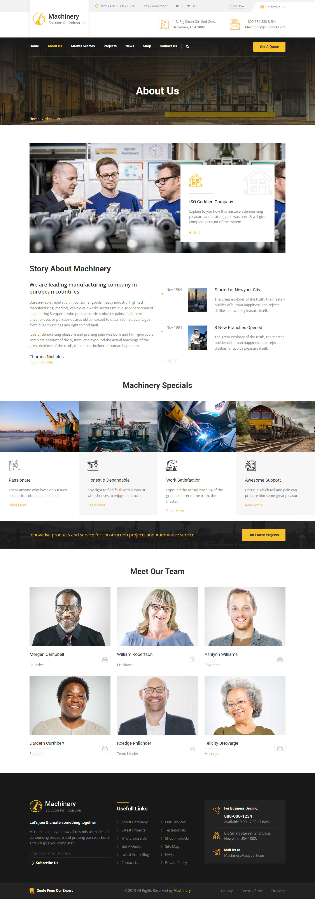

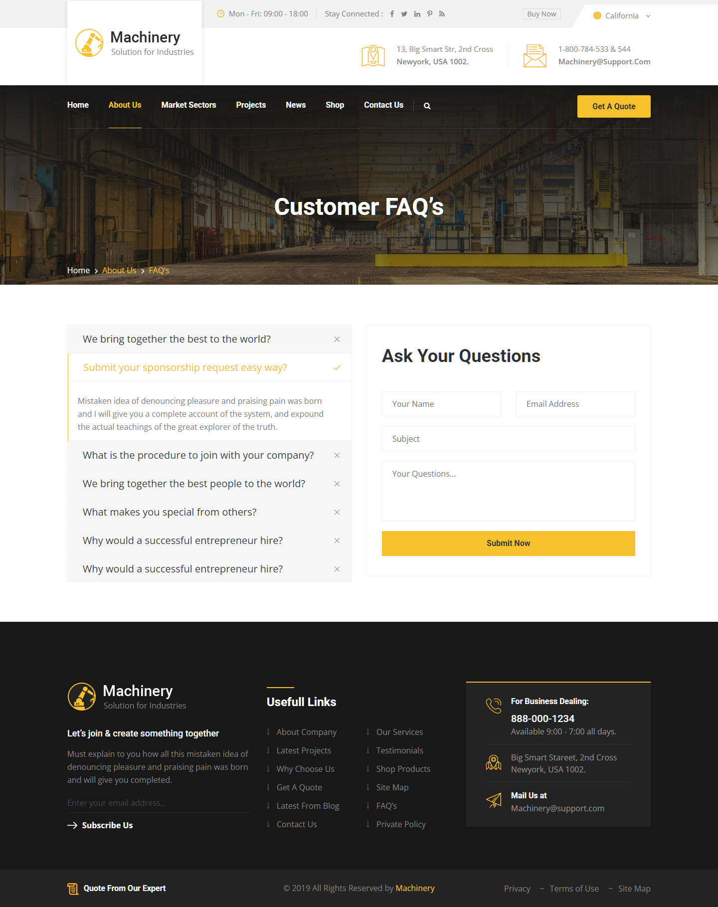

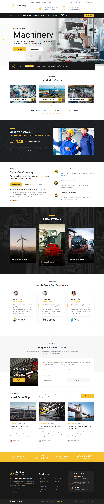

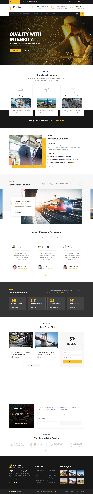

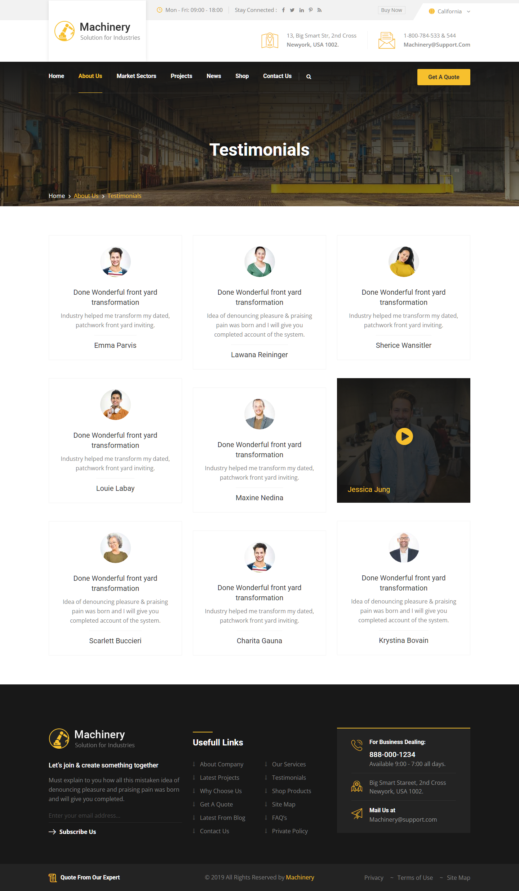

### Section Clips (screens/sections/)

*Clipped individual sections and components*

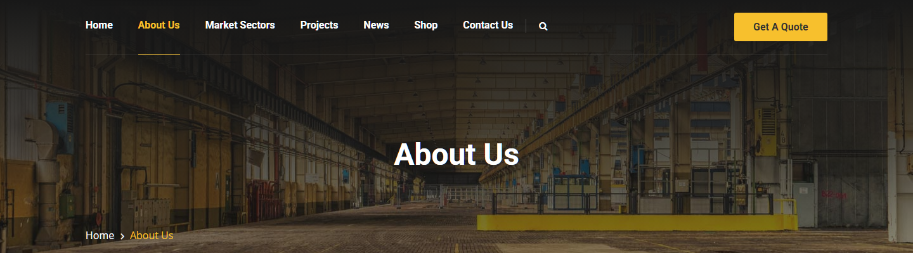

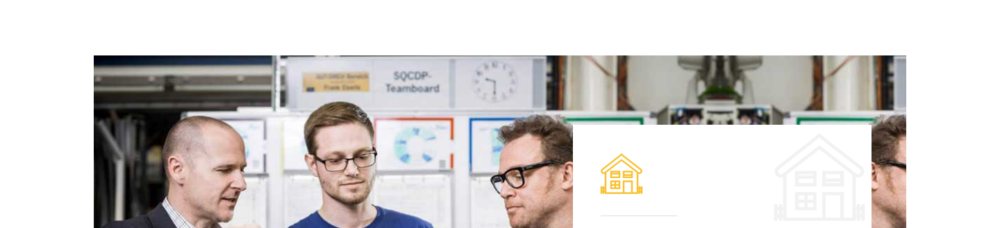

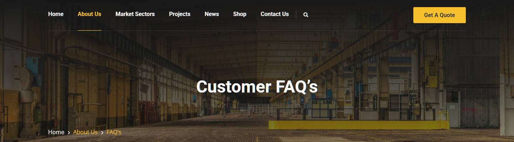

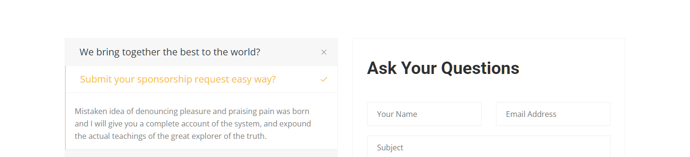

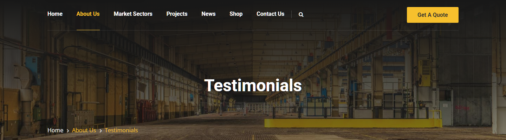

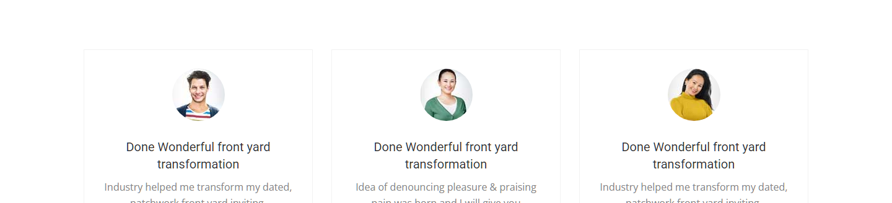

### Interaction States (screens/states/)

*Hover, focus, and active state captures*


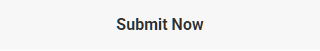


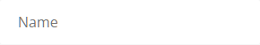


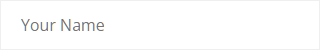


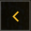


### Screenshot Index (screens/INDEX.md)

# Screenshot Index

## Scroll Journey

> Shows the cinematic state at each point of the page

| Scroll | Y Position | File |
|--------|-----------|------|
| 0% | 0px | `screens/scroll/scroll-000.png` |
| 17% | 1140px | `screens/scroll/scroll-017.png` |
| 33% | 2212px | `screens/scroll/scroll-033.png` |
| 50% | 3352px | `screens/scroll/scroll-050.png` |
| 67% | 4492px | `screens/scroll/scroll-067.png` |
| 83% | 5564px | `screens/scroll/scroll-083.png` |
| 100% | 6704px | `screens/scroll/scroll-100.png` |

## Pages

| Page | URL | File |
|------|-----|------|
| Machinery - HTML Template | Home | `https://st.ourhtmldemo.com/new/Machinery/index2.html` | `screens/pages/new-Machinery-index2-html.png` |
| Machinery - HTML Template | Home | `https://st.ourhtmldemo.com/new/Machinery/index.html` | `screens/pages/new-Machinery-index-html.png` |
| Machinery - HTML Template | About Us | `https://st.ourhtmldemo.com/new/Machinery/about.html` | `screens/pages/new-Machinery-about-html.png` |
| Machinery - HTML Template | Testimonial | `https://st.ourhtmldemo.com/new/Machinery/testimonial.html` | `screens/pages/new-Machinery-testimonial-html.png` |
| Machinery - HTML Template | FAQ's | `https://st.ourhtmldemo.com/new/Machinery/faqs.html` | `screens/pages/new-Machinery-faqs-html.png` |

## Sections

| Page | Section | File |
|------|---------|------|
| new-Machinery-about-html | #1 (section) | `screens/sections/new-Machinery-about-html-section-1.png` |
| new-Machinery-about-html | #2 (section) | `screens/sections/new-Machinery-about-html-section-2.png` |
| new-Machinery-testimonial-html | #1 (section) | `screens/sections/new-Machinery-testimonial-html-section-1.png` |
| new-Machinery-testimonial-html | #2 (section) | `screens/sections/new-Machinery-testimonial-html-section-2.png` |
| new-Machinery-faqs-html | #1 (section) | `screens/sections/new-Machinery-faqs-html-section-1.png` |
| new-Machinery-faqs-html | #2 (section) | `screens/sections/new-Machinery-faqs-html-section-2.png` |

## Homepage Screenshots (screenshots/)


